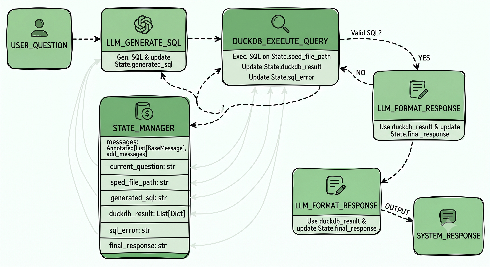

# agente_sped

Sistema de agentes autônomos utilizando **LangGraph** e **DuckDB** para análise preditiva e consultas analíticas diretamente em arquivos brutos de **SPED Fiscal (.txt)**.

O objetivo deste projeto é permitir que o usuário faça perguntas em linguagem natural sobre o documento fiscal. O agente orquestra a intenção, gera e corrige queries SQL automaticamente através de LLMs e executa essas consultas diretamente no arquivo de texto em alta performance utilizando o DuckDB.

---

## 🗺️ Arquitetura do Grafo (Fluxo do Agente)

O fluxo de execução do agente e a estrutura de estados do sistema foram desenhados da seguinte forma:



---

## 🛠️ Tecnologias Principais

* **Python 3.13** (Ambiente moderno e otimizado)
* **Poetry** (Gerenciamento de dependências e *Flat Layout*)
* **LangGraph** (Orquestração do fluxo de agentes baseado em estados)
* **DuckDB** (Engine SQL em memória para leitura ultrarrápida do SPED .txt)
* **Pydantic v2** (Validação de schemas e outputs estruturados)

---

## 📁 Estrutura do Projeto

O projeto adota o **Flat Layout** nativo do Poetry, eliminando pastas intermediárias de código-fonte e isolando as responsabilidades de forma clara:

```text
agente_sped/                   # Raiz do repositório Git
│
├── data/                       # Arquivos SPED brutos para testes locais
│   └── exemplo_sped.txt
│
├── agente_sped/                # O pacote Python principal do projeto
│   ├── __init__.py
│   │
│   ├── config/                 # Configurações globais e variáveis de ambiente
│   │   ├── __init__.py
│   │   └── settings.py
│   │
│   ├── database/               # Camada de infraestrutura e execução do DuckDB
│   │   ├── __init__.py
│   │   └── duckdb_client.py
│   │
│   ├── agent/                  # Coração da inteligência (LangGraph)
│   │   ├── __init__.py
│   │   ├── state.py            # Definição do SPEDAgentState
│   │   ├── graph.py            # Orquestrador, Edges e compilação do grafo
│   │   │
│   │   ├── nodes/              # Nós de processamento do grafo
│   │   │   ├── __init__.py
│   │   │   ├── generator.py    # Nó: LLM_GENERATE_SQL
│   │   │   ├── executor.py     # Nó: DUCKDB_EXECUTE_QUERY
│   │   │   └── formatter.py    # Nó: LLM_FORMAT_RESPONSE
│   │   │
│   │   └── prompts/            # Engenharia de prompts isolada do código
│   │       ├── __init__.py
│   │       ├── sql_generator.py
│   │       └── responder.py
│   │
│   └── utils/                  # Utilitários e mapeadores do SPED
│       ├── __init__.py
│       └── sped_parsers.py
│
├── tests/                      # Testes automatizados (pytest)
│   ├── __init__.py
│   ├── test_duckdb.py
│   └── test_graph.py
│
├── 9590275997527188501.jpeg    # Diagrama do Grafo
├── .env                        # Variáveis de ambiente locais (Ignorado)
├── .dockerignore
├── .gitignore
├── pyproject.toml              # Configurações do Poetry (Flat Layout)
└── README.md
```

---

## 🚀 Como Executar o Projeto

* **Pré-requisitos**
* **Python 3.13+**
* **Poetry instalado**

---

## 1. Clonar o repositório e Instalar as dependências

```Bash
git clone [https://github.com/seu-usuario/agente_sped.git](https://github.com/seu-usuario/agente_sped.git)
cd agente_sped
poetry install
```

---

## 2. Configurar as variáveis de ambiente

Crie um arquivo .env na raiz do projeto com as suas credenciais:

```Snippet de código
OPENAI_API_KEY=sua_chave_aqui
# ou se preferir utilizar o Gemini da Google:
GOOGLE_API_KEY=sua_chave_aqui
```

---

## 3. Executar os Testes Automatizados

Para garantir que a engine do DuckDB está interpretando corretamente o arquivo SPED local na pasta data/:

```Bash
poetry run pytest
```

---

## 🐳 Execução Direta via Linha de Comando

Caso prefira interagir diretamente com o CLI do Docker Engine, utilize os comandos equivalentes:

1.**Construir a imagem local:**

```bash
docker build -t agente-sped:latest .
```

2.**Rodar o container (Mapeando Volumes e Variáveis de Ambiente):**

```bash
docker run -it --rm --env-file .env -v $PWD/data:/app/data agente-sped:latest
```

```bash
docker compose run --rm agente-sped
```

## 💡 Princípios de Design Aplicados

* Clean Code & SRP: Cada nó do grafo possui responsabilidade única e seu código fica em arquivo isolado. A infraestrutura do DuckDB não se mistura com a regra de IA.
* Self-Correction: Caso a query gerada inicialmente falhe ao rodar no DuckDB, o grafo captura o sql_error no estado e permite que a LLM corrija o código SQL automaticamente antes de responder ao usuário
